# Resultados fase por fase

Las fases 0 a 4 son las del plan de trabajo. La sección 3d y la fase 5 se añadieron después de la revisión del 17 de octubre de 2026, y sus salidas están en `extra/`. Todas las rutas son relativas a `Model/Python/Results/plan/`. Los valores fijos, salvo que se indique otra cosa, son δ = 35, T = 15, t_max = 100, n = 8 nodos, los parámetros locales de la tabla 1 del manuscrito y r₃ = −0,3. E_T y E_U están en unidades de AUC de plaga evitado por parasitoide liberado.

---

## Fase 0. Preparación del código

### Cambios

1. `network_experiments.network_rhs` y `solve_network_data` aceptan `md` y `mt`, con valor por defecto 0. El término de dispersión es `-D * (L @ x + m * (A @ x))`. Con m = 0 el término extra ni siquiera se evalúa, así que el modelo original queda intacto bit a bit. `md` y `mt` también pueden ser matrices m_ij, que se usan en la fase 4.
2. `common.outbreak_ics(n, tt, kind)` elige entre CI-A, con 200 psílidos en el foco y 20 en los demás nodos, y CI-B, con 200 en el foco y 0 en los demás.
3. `core.n_releases(T, tt) = ceil(tt/T) - 1`, que además verifica que coincide con las liberaciones que el integrador aplica de verdad.
4. `plan_common.run_combo` resuelve las tres estrategias con parámetros idénticos y guarda k_s, n_rel, Q, los AUC, E_T, E_U, E_T/E_U, Π y Π_t.

### Pruebas (`test_phase0.py`, salida en `phase0/phase0_tests.json`)

| Prueba | Resultado |
|---|---|
| 1. Reproducir las 336 corridas del experimento 2 con m = 0 | error relativo máximo de PestAUC 4,1·10⁻¹⁶. Las demás métricas del CSV tampoco pasan de 2·10⁻¹³ |
| 2. Balance de masa sin dinámica local: d(Σx)/dt = −D·m·Σkᵢxᵢ | identidad algebraica 1,2·10⁻¹⁵; versión integrada 4,5·10⁻¹¹ (5 redes × 3 pares D, m × 2 especies) |
| 3. Con D = 0 cualquier m da lo mismo que m = 0 | diferencia exactamente 0 |
| 4. Estrella = completo con m = 0 | diferencia relativa < 10⁻¹⁴ en CI-A y CI-B y en las 3 estrategias |
| 5. n_rel = liberaciones aplicadas (añadida) | pasa para T ∈ {5, 7, 10, 15, 20, 30, 40} y t_max ∈ {100, 300} |
| 6. Tolerancia de los barridos (añadida) | rtol 10⁻⁸ en lugar de 10⁻¹⁰ cambia E_T en ≤ 8·10⁻⁹ y reduce el tiempo de cómputo a un 60 % |
| 7. Matriz m_ij constante = escalar m (añadida para la fase 4) | pasa |

La prueba 4 también registra cuánto difieren la estrella y el grafo completo cuando m_t > 0. Con D_d = D_t = 0,1, el AUC de la estrella es menor en 7 % con m_t = 0,05, en 13 % con 0,1, en 22 % con 0,2 y en 34 % con 0,4, casi igual en CI-A y CI-B. La explicación es que en el grafo completo cada nodo tiene grado 7 y pierde parasitoides en siete aristas, mientras que las hojas de la estrella solo tienen una.

**Criterio de paso cumplido.**

---

## Fase 1. Dispersión relativa sin costo

**Diseño.** D_t y D_d toman 9 valores logarítmicos en [10⁻³, 1]. Además r₃ ∈ {−0,2; −0,3; −0,45}, se usan 7 redes, CI-A y CI-B, y 3 estrategias. En total son 3402 combinaciones y 10 206 corridas. El piloto de 243 corridas con el grafo completo, CI-B y r₃ = −0,3 tardó 35 s y mostró respuestas suaves, sin valores negativos de E.

### Figura 1.1. Mapas de E_T y de E_T/E_U

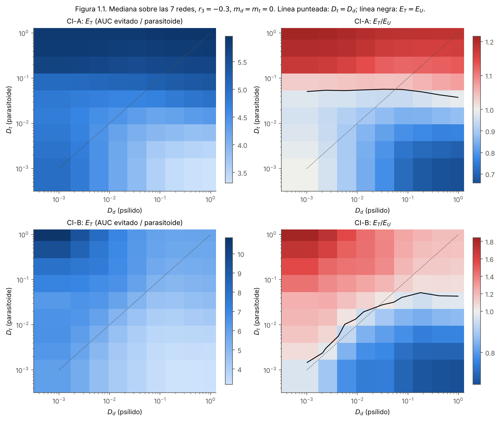

La figura muestra la mediana sobre las 7 redes con r₃ = −0,3. El mapa por red está en `fig1_1b_maps_by_network.png`.

- En CI-A, E_T depende casi solo de D_t. Las franjas son horizontales y la eficiencia sube de 3,3 a 5,9.
- En CI-B, E_T depende de las dos tasas. Es máxima con un parasitoide rápido y un psílido lento (arriba a la izquierda, hasta 10) y mínima en la esquina opuesta.
- La frontera E_T = E_U (línea negra) está cerca de D_t ≈ 0,05 en CI-A, sin importar D_d. En CI-B sigue aproximadamente la diagonal D_t ≈ D_d para D_d < 0,03. **La liberación dirigida conviene cuando el parasitoide se mueve al menos tanto como la plaga**, pero el umbral no es un cociente fijo.

### Figura 1.2. Curvas de colapso

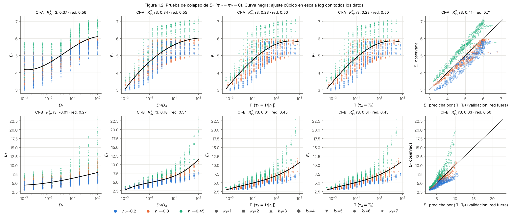

### Tabla 1.1. R² con validación cruzada (`phase1/table1_1_cv_r2.csv`)

El ajuste es un polinomio cúbico en log₁₀ de la candidata. Para el par (Π, Π_t) es un polinomio cúbico bivariado. Fuera del rango de entrenamiento la curva se prolonga como constante. La columna "mín." es la menor de las dos validaciones y es la que se usa en el criterio.

| CI | Candidata | R² en muestra | R² CV (r₃ fuera) | R² CV (red fuera) | mín. |
|---|---|---|---|---|---|
| A | D_t | 0,58 | 0,37 | 0,56 | 0,37 |
| A | D_t/D_d | 0,56 | 0,34 | 0,55 | 0,34 |
| A | Π (τ_d = 1/\|r₁\|) | 0,50 | 0,23 | 0,50 | 0,23 |
| A | Π (τ_d = T₀) | 0,50 | 0,23 | 0,50 | 0,23 |
| A | (Π, Π_t) | 0,72 | 0,41 | 0,71 | 0,41 |
| A | *referencia: (D_d, D_t)* | 0,74 | 0,52 | 0,71 | 0,52 |
| B | D_t | 0,28 | −0,01 | 0,27 | −0,01 |
| B | D_t/D_d | 0,55 | 0,18 | 0,54 | 0,18 |
| B | Π (τ_d = 1/\|r₁\|) | 0,46 | 0,01 | 0,45 | 0,01 |
| B | Π (τ_d = T₀) | 0,46 | 0,01 | 0,45 | 0,01 |
| B | (Π, Π_t) | 0,52 | 0,03 | 0,50 | 0,03 |
| B | *referencia: (D_d, D_t)* | 0,58 | 0,19 | 0,56 | 0,19 |

**Ninguna candidata colapsa los datos.** El umbral era R² ≥ 0,9 y una ganancia ≥ 0,1 sobre D_t/D_d. La fila de referencia, que no está en el plan, es una función libre de D_d y D_t. Muestra el máximo que puede explicar *cualquier* combinación de las dos tasas, y tampoco pasa de 0,52.

**Por qué falla.** Con la red fija, lo que queda sin explicar se debe sobre todo a r₃. En la figura 1.2 los tres colores forman bandas separadas. La mediana de E_T es 4,99, 5,56 y 6,71 en CI-B para r₃ = −0,2, −0,3 y −0,45. Una mortalidad natural mayor del parasitoide hace que la plaga sin liberaciones sea mucho mayor, con un AUC sin liberación de 18 500, 26 600 y 38 100, de modo que cada parasitoide liberado evita más plaga. Π trata r₃ solo como escala de tiempo. Al subir |r₃|, τ_t baja y Π baja, cuando E_T sube. Por eso Π queda por debajo incluso de D_t/D_d.

Con E_T/E_U como respuesta (`table1_1_cv_r2_Eratio.csv`) los R² suben (0,78 con (Π, Π_t) en CI-A), pero ninguna candidata llega a 0,9.

**Respuesta relativa (añadido en la revisión del 17 de octubre).** Si la respuesta es la fracción de plaga evitada, (AUC_None − AUC_T)/AUC_None, en lugar de E_T (`extra/table_C_collapse_relative.csv`), en CI-B el R² validado de Π sube de 0,01 a 0,60 y el de (Π, Π_t) de 0,03 a 0,65. Los dos superan a D_t/D_d (0,49) por más de 0,1, pero no llegan a 0,9. En CI-A todas las candidatas quedan con R² negativo. El resultado sigue siendo negativo según el criterio del plan, aunque en parte depende de medir la eficiencia en AUC absoluto.

**Consecuencia.** Según el plan, la fase 2 se hace igual y este resultado negativo se reporta. Si se busca una variable que generalice, habría que incluir algo que mida cuánta plaga hay para evitar (el AUC sin liberación, o b₃₁x̄₁/|r₃|), no solo escalas de tiempo de dispersión.

---

## Fase 2. Hipótesis Goldilocks sin costo de dispersión

**Diseño.** D_t toma 25 valores logarítmicos en [10⁻³, 1], con D_d ∈ {0,01; 0,03; 0,1}, 7 redes, CI-A y CI-B, t_max ∈ {100, 300} y 3 estrategias. En total son 2100 combinaciones y 6300 corridas. La verificación aparte usa D_d = 0, CI-A y 26 valores de D_t (incluido 0): 364 combinaciones y 1092 corridas.

### Figura 2.1. E_T contra D_t

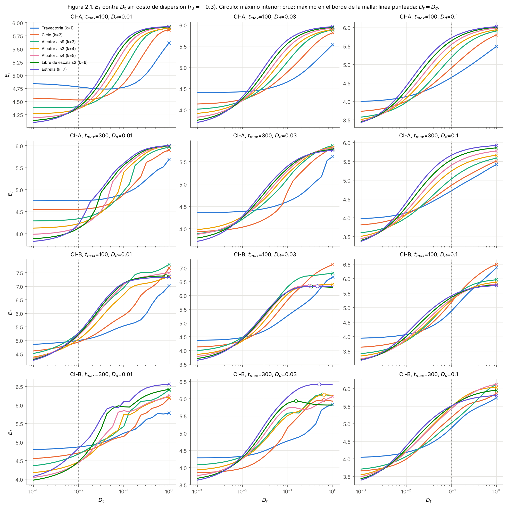

### Tabla 2.1 (`phase2/table2_1_optimum.csv`)

Resumen de las 84 curvas:

| CI | t_max | curvas | máximo en D_t = 1 | máximo interior | prominencia > 5 % |
|---|---|---|---|---|---|
| A | 100 | 21 | 21 | 0 | 0 |
| A | 300 | 21 | 21 | 0 | 0 |
| B | 100 | 21 | 17 | 4 | 0 |
| B | 300 | 21 | 16 | 5 | 0 |

Los 9 máximos interiores de CI-B están en D_t* entre 0,15 y 0,85, casi todos con D_d = 0,03. Tienen prominencias de 0,01 a 1,9 % y ninguno aparece en los dos horizontes. Son mesetas, no óptimos. La tabla completa trae D_t*, Π_t* = D_t*·k_s/|r₃|, la prominencia del plan (caída hasta D_t = 1) y la prominencia por la izquierda (caída hasta D_t = 10⁻³).

Con la liberación uniforme (`table2_1b_optimum_uniform.csv`) tampoco hay ningún máximo real en las 84 curvas.

**Interpretación.** La expectativa del plan para CI-A se cumple, porque no hay máximo. La de CI-B no se cumple. En lugar de un máximo aparece una saturación, porque los parasitoides que llegan pronto a nodos sin plaga no se pierden del todo. Siguen vivos (r₃ actúa a la misma tasa en cualquier nodo) y vuelven a moverse. **No hay un mecanismo de óptimo sin costo que describir antes de la fase 3**, así que todo óptimo que aparezca en la fase 3 se debe a la mortalidad en tránsito.

Con t_max = 300 las curvas tienen ondulaciones. No son error numérico. Vienen de la dinámica oscilatoria del sistema, que tiene un foco débilmente inestable con período de 6,8 a 8,4. Su fase respecto del calendario de liberaciones cambia con D_t.

### Figura 2.2. Verificación con D_d = 0

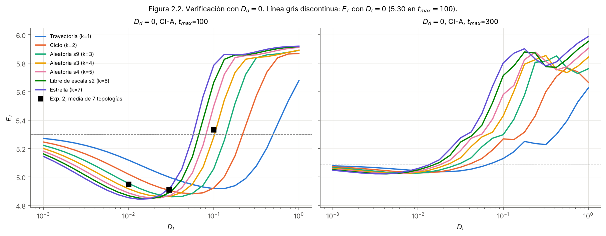

La caída de 5,30 a 4,91 en la fila D_d = 0 del experimento 2 **es real, no un efecto de la malla gruesa**. E_T(D_t) tiene un valle. Baja desde 5,30 con D_t = 0 hasta unos 4,85, con el mínimo entre D_t ≈ 0,015 en la estrella y ≈ 0,1 en la trayectoria. Luego sube por encima de 5,30, desde D_t ≈ 0,06 en la estrella y desde ≈ 0,5 en la trayectoria. Los tres puntos del experimento 2 (cuadrados negros, media de sus 7 topologías) caen justo en el valle. Con t_max = 300 el valle casi desaparece y la curva es plana hasta D_t ≈ 0,02.

---

## Fase 3. Mortalidad en tránsito

### 3a. Mortalidad solo del parasitoide

**Diseño.** m_t ∈ {0; 0,05; 0,1; 0,2; 0,4}, D_t en 13 valores logarítmicos en [10⁻³, 1], D_d ∈ {0,01; 0,03; 0,1}, 8 redes (las 7 del plan más el grafo completo, ver CORRECCIONES), CI-B y CI-A, r₃ ∈ {−0,3; −0,45} y 3 estrategias. En total son 6240 combinaciones y 18 720 corridas. El subconjunto de 7 redes son las 16 380 corridas del plan. El piloto de 585 corridas mostró la cresta desde el principio.

#### Figura 3.1. E_T en el plano (D_t, m_t)

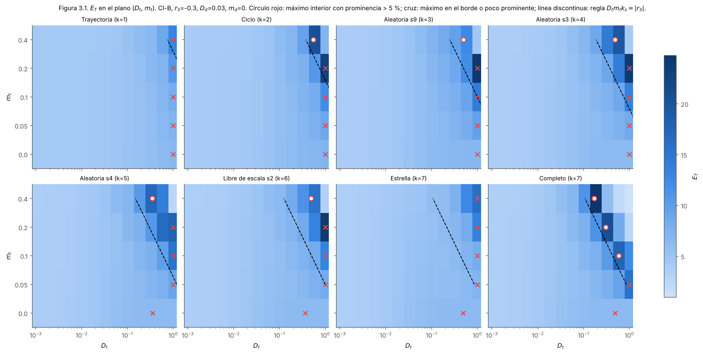

La figura corresponde a CI-B, r₃ = −0,3 y D_d = 0,03. La versión con CI-A está en `fig3_1b_maps_Dt_mt_CIA.png`. **La cresta existe**. Con m_t = 0 no hay ningún máximo real en las 96 condiciones. Con m_t > 0 hay 127 máximos interiores con prominencia > 5 % (68 en CI-B y 59 en CI-A), con prominencia mediana del 73 %. El máximo se desplaza a D_t menores cuando m_t crece, tal como predecía la hipótesis. Cuando la cresta cae fuera de la malla (D_t* > 1), como en la trayectoria o la estrella con m_t pequeño, el máximo queda en el borde.

#### Figura 3.5. Mecanismo (análisis añadido)

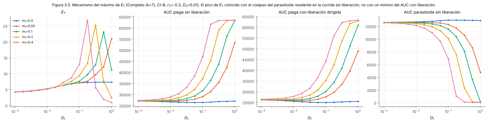

El análisis que explica la cresta no estaba en el plan, pero es necesario para interpretarla.

- El AUC de plaga **con** liberación dirigida (tercer panel) crece de forma monótona con D_t cuando m_t > 0. No tiene un mínimo en la cresta. En las 384 curvas con m_t > 0, el mínimo interior del AUC con liberación, cuando existe, mide 0,9 % en la mediana. **Excepción:** en la trayectoria y el ciclo con CI-B ese mínimo sí es apreciable, hasta 15 %, y 31 curvas pasan del 5 %. El mínimo está en D_t ≈ 0,02 a 0,1, muy lejos de la cresta de E_T. La fase 5 muestra que, sin parasitoide residente, ese mínimo aparece en casi todas las redes.
- El AUC de plaga **sin** liberación (segundo panel) se dispara antes, porque el parasitoide residente colapsa (cuarto panel). En la cresta, el AUC del parasitoide sin liberaciones es entre 2 y 40 % del que tiene con m_t = 0 y el mismo D_t, con mediana del 20 %.
- E_T es la diferencia de las dos curvas dividida por Q. Es máxima justo donde el residente ya colapsó en la corrida de referencia pero las liberaciones todavía logran sostener parasitoides. Más a la derecha también mueren los liberados y E_T cae a casi 0.

En consecuencia, **la cresta es un óptimo de eficiencia relativa al contrafactual sin liberación, no un óptimo de control**. Para el manuscrito conviene presentarla así, como el D_t con el que una liberación hace más diferencia, y no como el D_t que deja menos plaga.

#### Figura 3.2. La regla D_t*·m_t·k_s ≈ |r₃|

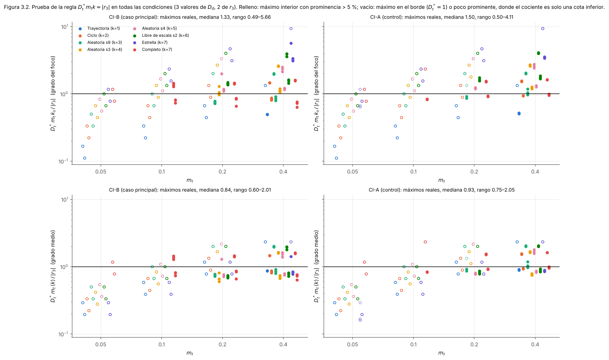

| Versión | Condiciones | Mediana | Rango | DE de log₁₀ |
|---|---|---|---|---|
| D_t*·m_t·k_s/\|r₃\| (plan) | 127 máximos reales | 1,36 | 0,49–5,66 | 0,23 |
| D_t*·m_t·⟨k⟩/\|r₃\| (grado medio, añadido) | 127 máximos reales | 0,89 | 0,60–2,05 | 0,16 |

- Con k_s el cociente queda **cerca de 1 en orden de magnitud, pero depende de la red**. Vale unos 3,4 en la estrella, donde el foco tiene grado 7 pero las hojas grado 1, y unos 0,5 en la trayectoria. Por red, el cociente es casi constante al variar m_t y D_d. La pendiente de log D_t* contra log m_t tiene una mediana de −0,91 (rango intercuartílico −0,95 a −0,87).
- Con el grado medio de la red ⟨k⟩ la dispersión entre redes casi desaparece. Tiene sentido, porque el colapso del residente ocurre en toda la red, no solo en el foco.
- La constante depende de r₃. En CI-B, D_t*·m_t·⟨k⟩ vale 0,46 (de 0,39 a 0,60) con r₃ = −0,3 y 0,35 (de 0,27 a 0,41) con r₃ = −0,45. **La pérdida en la cresta disminuye cuando |r₃| crece**, al revés de lo que dice la regla. La lectura más simple, posterior a los datos, es un umbral de persistencia del parasitoide residente, D_t·m_t·⟨k⟩ ≈ b₃₁·x̄₁ − |r₃|. Aquí x̄₁ es la densidad de plaga cuando el parasitoide ya colapsó, que en las corridas vale 79,5 por nodo en CI-B y 86 en CI-A. Esto predice 0,50 y 0,35 en CI-B, y 0,56 y 0,41 en CI-A, contra 0,46, 0,35, 0,49 y 0,39 observados. No es una derivación y habría que demostrarla antes de usarla en el texto.

#### Figura 3.3. Efecto del grado del foco

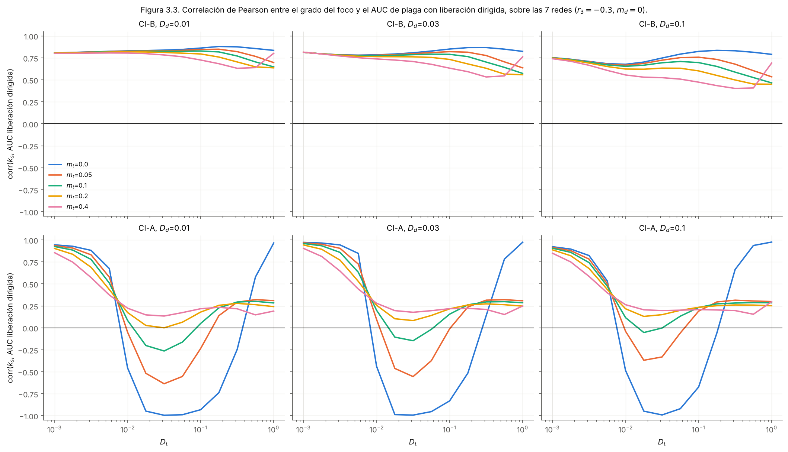

La figura muestra la correlación de Pearson entre k_s y el AUC con liberación dirigida, calculada sobre las 7 redes.

- En CI-A con m_t = 0 la correlación es −0,99 en D_t ≈ 0,02 a 0,05, el resultado conocido. Fuera de ese rango cambia de signo, cerca de +0,95 en los dos extremos de la malla (D_t = 10⁻³ y D_t = 1).
- Con D_d = 0,03 y D_t = 0,03, en CI-A, pasa de −0,99 con m_t = 0 a −0,55, −0,15, +0,08 y +0,18 con m_t = 0,05, 0,1, 0,2 y 0,4. **El signo se invierte** con m_t ≥ 0,2, como anticipaba el plan.
- En CI-B la correlación es positiva en todas las condiciones (+0,40 a +0,88). Un foco muy conectado esparce antes una plaga que no estaba en otros nodos, y esto pesa más que la ventaja de dispersar parasitoides.

Tabla en `phase3/table3_3_degree_correlation.csv`.

### 3b. Mortalidad también de la plaga

**Diseño.** m_d ∈ {0,1; 0,2} sobre una malla reducida alrededor de la cresta (m_d = 0 se toma de 3a), con m_t ∈ {0,05; 0,1; 0,2; 0,4}, 7 valores de D_t en [0,03; 1], D_d ∈ {0,01; 0,03; 0,1}, 8 redes, CI-B y r₃ = −0,3. Son 1344 combinaciones y 4032 corridas. Cada eficiencia se calcula contra la corrida sin liberación con el mismo m_d.

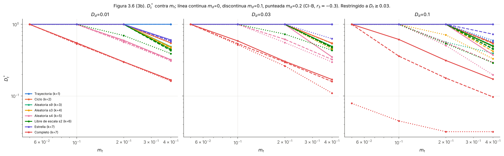

Desplazamiento de D_t* respecto de m_d = 0, en las condiciones donde había un máximo interior con m_d = 0 (`table3_6_phase3b_optimum.csv`):

| D_d | m_d = 0,1, mediana (rango) | m_d = 0,2, mediana (rango) |
|---|---|---|
| 0,01 | −2 % (−4 a 0) | −4 % (−13 a 0) |
| 0,03 | −3 % (−8 a −1) | −11 % (−35 a −1) |
| 0,1 | −18 % (−44 a −2) | −45 % (−93 a −11) |

D_t* **siempre baja** cuando la plaga también paga por dispersarse, y el efecto crece con D_d·m_d, que es la pérdida de la plaga. El caso extremo es el grafo completo con D_d = 0,1 y m_d = 0,2, donde la plaga pierde 0,14 por unidad de tiempo solo en tránsito. Ahí el óptimo cae al borde inferior de la malla reducida (D_t = 0,03), así que ese valor es solo una cota.

La reducción de la plaga atribuible a m_d, sin liberaciones (`table3_7_pest_reduction_by_md.csv`), tiene una mediana de 1,8 % con m_d = 0,1 (máximo 30 %) y de 3,6 % con m_d = 0,2 (máximo 60 %, en el grafo completo con D_d = 0,1).

### 3c. Consecuencias para los resultados del manuscrito

**Equivalencia estrella–completo.**

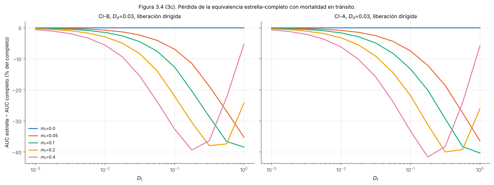

Con m_t = 0 la diferencia es 0. Con m_t > 0 la estrella siempre tiene menos AUC de plaga que el completo. La diferencia es casi nula con D_t pequeño y crece hasta 36 a 42 % con D_t grande, según m_t. La proposición de equivalencia deja de valer en cuanto hay mortalidad en tránsito. Tabla en `table3_4_star_vs_complete.csv`.

**Estabilidad del estado sincrónico** (`run_phase3c_stability.py`, `phase3c_stability.csv`). En un grafo k-regular se cumple (L + mA)v = (mk + (1 − m)μ)v. El modo sincrónico es entonces el modelo de un nodo con r₁' = r₁ − D_d m_d k y r₃' = r₃ − D_t m_t k, y cada modo transversal es el problema de estabilidad maestra con acoplamiento (1 − m)D. La reducción se verificó numéricamente con un error relativo < 4·10⁻¹³. Con m_t = 0 se reproducen exactamente los exponentes del experimento 4.

| Red | m_t = 0 | 0,05 | 0,1 | 0,2 | 0,4 |
|---|---|---|---|---|---|
| Ciclo (k = 2) | −0,00077 | −0,00195 | −0,00259 | −0,00143 | −0,00132 |
| Completo (k = 7) | −0,0131 | −0,0171 | −0,0150 | −0,0155 | −0,0165 |

Las cifras son el máximo exponente de Lyapunov transversal, con D_d = D_t = 0,03 y liberación uniforme. El estado sincrónico sigue siendo estable en los dos casos y la mortalidad lo estabiliza un poco más. Para otras redes no existe estado sincrónico cuando m > 0.

### Criterio de paso a la fase 4 (`phase3/gate_phase4.json`)

- Máximo interior con prominencia > 5 % en al menos dos valores de m_t > 0. Se cumple en 19 de las 48 condiciones de CI-B (red × D_d × r₃) y en 5 redes, el grafo completo y las cuatro aleatorias.
- Relación estable entre D_t* y m_t. La pendiente log–log tiene mediana −0,91 y rango intercuartílico de −0,95 a −0,87 entre redes.

**Se cumple, así que la fase 4 se ejecutó.**

### 3d. Malla de D_t extendida (añadido en la revisión del 17 de octubre)

**Motivo.** La malla de 3a termina en D_t = 1, y ahí quedaban 255 de las 384 curvas con m_t > 0. Con m_t = 0,05 no había ningún máximo real, 13 de las 19 pendientes de la compuerta salían de solo dos puntos y 15 de ellas eran con r₃ = −0,45.

**Diseño.** Las mismas condiciones de 3a (8 redes, CI-A y CI-B, 3 valores de D_d, 2 de r₃ y 5 de m_t), con seis valores más de D_t que siguen el mismo paso de 0,25 décadas, de 1,78 a 31,6. Son 2880 combinaciones y 8640 corridas (`run_extra_phase3a_extended.py`). Junto con `phase3a_grid.csv` dan 19 valores de D_t en [10⁻³; 31,6]. Las salidas están en `extra/`.

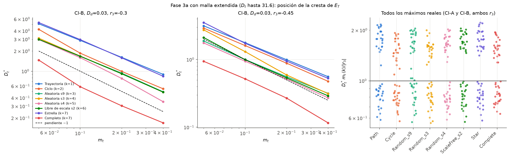

- Las 384 curvas con m_t > 0 tienen un máximo interior con prominencia > 5 %. Ninguna queda en el borde. Con m_t = 0 sigue sin haber ningún máximo (0 de 96).
- Cada pendiente de log D_t* contra log m_t se ajusta ahora con 4 puntos (96 ajustes). La mediana es −0,92 (rango intercuartílico −1,04 a −0,87), y −0,89 en CI-B con r₃ = −0,3. **D_t* ∝ 1/m_t se confirma con datos completos.**
- El grado medio funciona claramente mejor que el grado del foco. Con ⟨k⟩, la desviación estándar de log₁₀ del cociente D_t*·m_t·⟨k⟩/|r₃| es de 0,04 a 0,06 dentro de cada (CI, r₃). Con k_s es de 0,24 a 0,25.
- La pérdida en tránsito en la cresta, D_t*·m_t·⟨k⟩, es casi constante para cada r₃ y baja cuando |r₃| sube (`extra/table_A_ext_rule.csv`):

| CI | r₃ | D_t*·m_t·⟨k⟩ (mediana) | D_t*·m_t·⟨k⟩/\|r₃\| (rango) |
|---|---|---|---|
| B | −0,30 | 0,475 | 1,58 (1,09–2,12) |
| B | −0,45 | 0,325 | 0,72 (0,56–0,91) |
| A | −0,30 | 0,532 | 1,78 (1,50–2,22) |
| A | −0,45 | 0,397 | 0,88 (0,73–1,18) |

Cuando se citen en el texto, conviene usar estas cifras en lugar de las de la tabla de la figura 3.2. Aquella solo incluía los 127 máximos que caían dentro de la malla, que estaban sesgados hacia m_t grande y r₃ = −0,45. La regla del plan acierta en la escala y en la dependencia 1/m_t, pero no en la dependencia con r₃.

---

## Fase 4. Mortalidad que depende de la arista

**Diseño.** Se usan 10 grafos geométricos aleatorios conexos de 8 nodos en el cuadrado unitario, con radio de conexión 0,5. Se descartaron las semillas 1, 4 y 10 porque daban grafos desconexos. La mortalidad es m_ij = 1 − exp(−d_ij/ℓ) con ℓ ∈ {0,5; 1; 2}, lo que da una media de m de 0,47, 0,28 y 0,15. D_t toma 15 valores en [0,03; 3], con D_d = 0,03, CI-B y r₃ = −0,3. Son 450 combinaciones y 900 corridas.

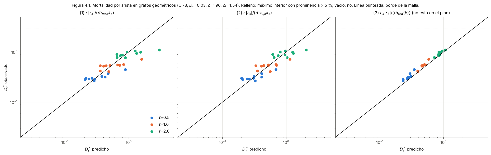

Las 30 curvas tienen un máximo interior con prominencia de 89 a 98 %. Las constantes se tomaron de los máximos reales de la fase 3 con el mismo r₃ y la misma CI: c = 1,96 para k_s y c_k = 1,54 para ⟨k⟩.

| Predicción | Error mediano | Sesgo | Correlación (log) |
|---|---|---|---|
| (1) c\|r₃\|/(m̄_foco·k_s), del plan | 22 % (0,088 décadas) | −4 % | 0,86 |
| (2) c\|r₃\|/(m̄_flujo·k_s), del plan | 24 % (0,092 décadas) | +3 % | 0,88 |
| (3) c_k\|r₃\|/(m̄_red·⟨k⟩), añadida | 10 % (0,040 décadas) | +10 % | 0,99 |

- La regla de la fase 3 **se mantiene con mortalidad heterogénea**. Basta con usar una mortalidad media.
- La ponderación por flujo, (2), no mejora sobre la media simple, (1). Dentro de cada ℓ la correlación con lo observado es incluso menor (0,59 a 0,82, frente a 0,76 a 0,91).
- La versión con el grado medio, (3), es claramente mejor. Dentro de cada ℓ su correlación es de 0,88 a 0,97, y después de corregir la constante la dispersión residual es de solo 6 %. D_t* depende poco del grado del foco. Dentro de cada ℓ, k_s varía de 2 a 6 pero D_t* varía menos de un factor 1,8.

**Precaución.** Con m_ij heterogéneo no hay estado sincrónico en ninguna red, así que el análisis de estabilidad no se puede repetir en esta fase.

---

## Fase 5 (añadida en la revisión del 17 de octubre). Óptimo de control sin parasitoide residente

**Motivo.** En el plan todos los nodos empiezan con x₃ = 15. Con mortalidad en tránsito, ese residente colapsa en la corrida sin liberación. Por eso la cresta de E_T de la fase 3 es un óptimo de eficiencia frente a un contrafactual que se deteriora, y no un mínimo de plaga (figura 3.5). Esta fase pregunta si existe un D_t que **deje menos plaga** cuando el parasitoide se introduce donde todavía no está establecido.

**Diseño.** x₃(0) = 0 en todos los nodos y la plaga como en CI-B (la condición se registra como `CI = B0`). Se usan las 8 redes, D_t en 25 valores logarítmicos en [10⁻³; 10], m_t ∈ {0; 0,05; 0,1; 0,2; 0,4}, D_d ∈ {0,01; 0,03; 0,1}, r₃ ∈ {−0,3; −0,45}, m_d = 0 y las tres estrategias. Son 6000 combinaciones y 18 000 corridas (`run_extra_no_resident.py`), con salidas en `extra/`. La corrida sin liberación no depende de D_t (su variación es exactamente 0), así que **un máximo de E_T es un mínimo real del AUC de plaga**.

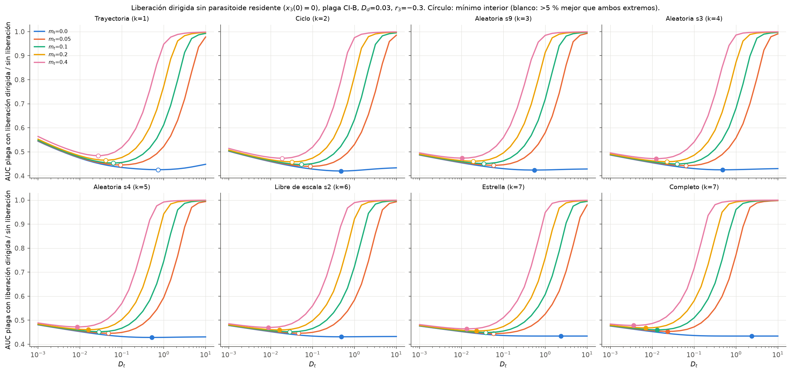

- Hay un mínimo interior del AUC con liberación dirigida en 236 de las 240 curvas.
- En 110 curvas ese mínimo es más de 5 % mejor que los dos extremos de la malla. Por red: trayectoria 27, ciclo 25, aleatorias 42, libre de escala 7, estrella 8, completo 1.
- El óptimo es **asimétrico**. Con m_t > 0, dispersarse demasiado deja entre 44 y 47 % más plaga (mediana), porque los parasitoides liberados mueren en tránsito. Dispersarse poco cuesta entre 3 y 7 % (mediana), y hasta 18 % en la trayectoria. Sin costo (m_t = 0) el máximo de la malla tiende a una meseta en D_t alto, salvo en la trayectoria.
- D_t* baja con m_t con una pendiente log–log de −0,73 (rango intercuartílico −0,76 a −0,67), menos pronunciada que la de la cresta de eficiencia (−0,92). La pérdida en tránsito en el óptimo, D_t*·m_t·⟨k⟩, vale entre 0,005 y 0,02, unas 30 veces menos que en la cresta de la fase 3 (`extra/table_B_no_resident_*.csv`).
- Ejemplo con D_d = 0,03 y r₃ = −0,3: D_t* va de 0,093 a 0,027 en la trayectoria y de 0,023 a 0,004 en el grafo completo, para m_t de 0,05 a 0,4. En la trayectoria eso deja 14 a 18 % menos plaga que con D_t = 10⁻³ y 51 a 54 % menos que con D_t = 10.

**Interpretación.** Cuando el parasitoide se introduce donde no estaba establecido, hay un D_t que minimiza la plaga y baja con el costo de dispersión, como proponía la hipótesis Goldilocks. Es un óptimo de **control**, distinto de la cresta de **eficiencia** de la fase 3, y está a una escala de D_t mucho menor. El beneficio frente a un parasitoide poco móvil es moderado y mayor en redes alargadas y poco conectadas. El costo de un parasitoide demasiado móvil es grande en todas las redes.
